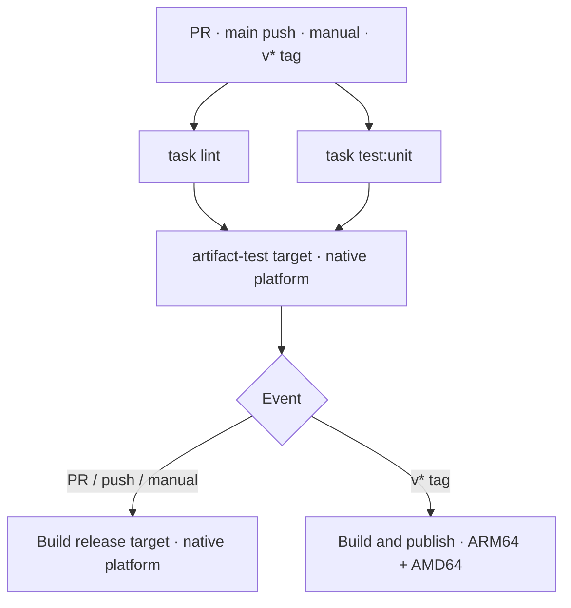
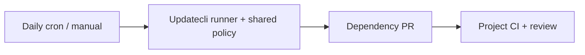

# RevoTale CI

Shared tools and CI conventions for RevoTale projects.
Workflows stay in each repository; images and dependency policies are reused.

[Workflow example](examples/woodpecker.yaml) ·
[Dependency updates](docs/integrate-dependency-updates.md) ·
[Release flow](docs/release.md) ·
[Releases](https://github.com/RevoTale/ci/releases)

## What you can reuse

| Component | Purpose |
| --- | --- |
| `ghcr.io/revotale/ci/base` | Go and Task on Debian Trixie. |
| `ghcr.io/revotale/ci/buildx` | Official Buildx plugin with required image metadata. |
| `ghcr.io/revotale/ci/updatecli` | Updatecli with Go and Git for dependency updates. |
| `ghcr.io/revotale/ci/policies/dependencies:0.2.0` | Shared dependency discovery and GitHub PR configuration. |

Images support ARM64 and AMD64. Policy versions are independent of image versions.

## Minimal start

Provide `task lint` and `task test:unit`, then create `.woodpecker.yaml`:

```yaml
when:
  - event: [pull_request, manual]
  - event: push
    branch: ${CI_REPO_DEFAULT_BRANCH}
  - event: tag
    ref: refs/tags/v*

steps:
  - name: lint
    image: ghcr.io/revotale/ci/base:v0.1.5@sha256:6e63627e23192f3e6258776bc9eeca0cc42829b1c447bc252ece997541e73f09
    depends_on: []
    commands: [task lint]

  - name: unit
    image: ghcr.io/revotale/ci/base:v0.1.5@sha256:6e63627e23192f3e6258776bc9eeca0cc42829b1c447bc252ece997541e73f09
    depends_on: []
    commands: [task test:unit]
```

Both checks run in parallel, once per pipeline.

## Choose how checks run

| Environment | Use when | Example |
| --- | --- | --- |
| Go and Task | The base image provides everything your tasks need. | Minimal start above |
| Project toolchain and services | Checks need extra tools or PostgreSQL. | [Services](examples/checks-services.yaml) |
| Dockerfile targets | Keep tool installation and checks in the repository without publishing a toolchain image. | [Dockerfile checks](examples/checks-dockerfile.yaml) |

These are alternatives. Run each check once.

The Taskfile contract is the same: `task lint`, `task test:unit`,
and `task test:integration` when needed. Invoke tasks through workflow
`commands` or Dockerfile `RUN`.

See [check environments](docs/check-environments.md) before connecting
these examples to build and publication.

## Add builds when needed

Replace the minimal workflow with one example:

| What you produce | Example |
| --- | --- |
| Docker images | [Docker workflow](examples/woodpecker.yaml) |
| Binaries, archives or other files | [Task workflow](examples/task-workflow.yaml) |

Each example already includes lint and unit tests.
Do not install it alongside the minimal workflow or the other example.

Add [integration tests or release publication](docs/optional-steps.md)
only when needed. For projects producing both images and files, share
the checks as described in that guide.

## Configure the selected workflow


1. Choose the [Docker workflow](examples/woodpecker.yaml) or
   [Task workflow](examples/task-workflow.yaml).
2. Set explicit tool image versions and project-specific settings.
3. Provide `task lint` and `task test:unit`.
4. For Docker images, add `artifact-test` and `release` targets.
   For Task commands, keep only the capabilities your project implements.
5. Configure the agent and secrets below.

The YAML belongs to your project. There is no remote workflow include,
configuration extension or generator.

Add `task test:integration`, `task build`, `task test:artifact`,
`task publish` and `task release` only when the project needs them.
Native plugins can handle image builds and publication.

See [optional steps](docs/optional-steps.md) for dependencies,
environment setup and examples of removing unused capabilities.

## How the Docker workflow runs



Checks use the builder's native platform. Only release publication builds
ARM64 and AMD64. Additional check platforms are an explicit project choice.
See [optional steps](docs/optional-steps.md) for integration tests and
the Task workflow.

Working-branch pushes do not duplicate PR checks. Each release tag runs
its own checks before publishing. Other tags are ignored.

Artifact checks run during the Dockerfile build. Both targets share
the runtime stage; matching layers are reused through Buildx cache.

Cache is shared between steps in one workflow. Persistent and
cross-project caching require separate configuration.

[Real Dockerfile](images/go-task/Dockerfile) ·
[Why tests live in Dockerfile targets](ARTIFACT_TESTING.md) ·
[Multiple images with a matrix](.woodpecker/image.yaml)

## Agent and credentials

Use a dedicated CI machine and require approval for untrusted PRs.
Allow the exact Buildx image used by the workflow: our wrapper needs
the same builder privileges as the official plugin.

| Secret | Used for | Allowed events |
| --- | --- | --- |
| `registry_username`, `registry_password` | Publishing images and policies | `tag` |
| `forge_token` | Release preparation and publication | Default-branch `push`, `tag` |
| `forge_token` | Dependency PRs, when enabled | `cron`, `manual` |

Registry credentials need push access. Forge credentials need repository
contents and pull-request write access. Do not expose them to PR checks.

Default-branch pushes prepare release PRs and tag the checked commit.
The tag pipeline publishes artifacts, runs consumer smoke checks, then publishes
the release. See [release flow](docs/release.md).

## Dependency updates



Connect with two files: an Updatecli compose file and a Woodpecker workflow.
There is no automerge.

Follow the [integration guide](docs/integrate-dependency-updates.md)
for files, registry access, secrets and cron setup.
The current policy uses GitHub; do not assign the same dependencies
to both Updatecli and another updater.

## What is enforced

Our Buildx wrapper requires `title`, `description`, `authors` and `licenses`.
It checks that values are present, not that they are correct.
A workflow that bypasses the wrapper also bypasses these checks.

Keep image versions explicit in every step so dependency updates show
exactly which steps change.

## For contributors and AI agents

Read [AGENTS.md](AGENTS.md) and [DECISIONS.md](DECISIONS.md) before proposing changes.
For project integration, start with the linked examples and guides.

Build shared functionality here. Propose extraction into
[woodpecker-toolkit](https://github.com/RevoTale/woodpecker-toolkit)
only when it provides clear value outside RevoTale.
