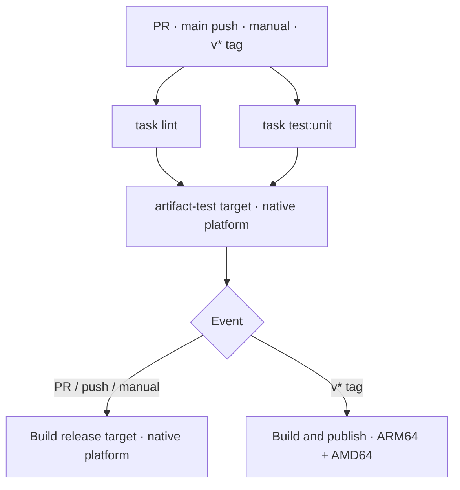

# RevoTale CI

Run your project’s checks in Woodpecker and publish its artifacts when you tag a release. Choose a workflow below and keep its YAML in your repository.

[Migrate a repository](docs/migrate.md) ·
[Dependency updates](docs/integrate-dependency-updates.md) ·
[Release flow](docs/release.md) ·
[Releases](https://github.com/RevoTale/ci/releases)

## Choose a workflow

| Project output | Starting point |
| --- | --- |
| Checks only | [Minimal start](#minimal-start) |
| Docker images | [Docker workflow](examples/woodpecker.yaml) |
| Binaries, archives or other files | [Task workflow](examples/task-workflow.yaml) |

Each starting point includes lint and unit tests. For both images and files,
[share validation](docs/optional-steps.md#keep-checks-in-one-place).

## Minimal start

Enable the repository in Woodpecker. From the repository root, run `task lint` and `task test:unit` to confirm both tasks exist and pass. If Go and Task provide all the tools they need, save this as `.woodpecker.yaml`:

```yaml
when:
  - event: [pull_request, manual]
  - event: push
    branch: ${CI_REPO_DEFAULT_BRANCH}
  - event: tag
    ref: refs/tags/v*

steps:
  - name: lint
    image: ghcr.io/revotale/ci/base:v0.1.5@sha256:6e63627e23192f3e6258776bc9eeca0cc42829b1c447bc252ece997541e73f09
    depends_on: []
    commands: [task lint]

  - name: unit
    image: ghcr.io/revotale/ci/base:v0.1.5@sha256:6e63627e23192f3e6258776bc9eeca0cc42829b1c447bc252ece997541e73f09
    depends_on: []
    commands: [task test:unit]
```

Open a pull request. In Woodpecker, look for two parallel steps, `lint` and `unit`. Open a failed step to see the output of its Task command.

If your tasks need extra tools or services, choose a [check environment](docs/check-environments.md).
Add [optional steps](docs/optional-steps.md) for capabilities the project uses.

## How the Docker workflow runs



Checks use the builder's native platform. Only release publication builds
ARM64 and AMD64. Additional check platforms are an explicit project choice.
See [optional steps](docs/optional-steps.md) for integration tests and
the Task workflow.

Working-branch pushes do not duplicate PR checks. Each release tag runs
its own checks before publishing. Other tags are ignored.

Artifact checks run during the Dockerfile build. Both targets share
the runtime stage; matching layers are reused through Buildx cache.

Cache is shared between steps in one workflow. Persistent and
cross-project caching require separate configuration.

[Real Dockerfile](images/go-task/Dockerfile) ·
[Why tests live in Dockerfile targets](ARTIFACT_TESTING.md) ·
[Multiple images with a matrix](.woodpecker/image.yaml)

## Shared components

| Component | When to use it |
| --- | --- |
| `ghcr.io/revotale/ci/base` | Run Go and Task commands on Debian Trixie. |
| `ghcr.io/revotale/ci/buildx` | Build a Docker image and publish it with the project’s name, purpose, authors and license. |

Both images support ARM64 and AMD64.

## Agent and credentials

Use a dedicated CI machine and require approval for untrusted PRs.
Allow the exact Buildx image used by the workflow: our wrapper needs
the same builder privileges as the official plugin.

| Secret | Used for | Allowed events |
| --- | --- | --- |
| `registry_username`, `registry_password` | Publishing images | `tag` |
| `forge_token` | Release PRs and forge releases | Default-branch `push` |

Registry credentials need push access. Forge credentials need repository
contents and pull-request write access. Do not expose them to PR checks.

In RevoTale/ci itself, merging a release PR triggers the tag and forge release after main checks pass.
The tag pipeline publishes artifacts and verifies them for consumers.
See [release flow](docs/release.md).

## Dependency updates

Updatecli is a companion tool. Use only official Updatecli releases, plugins
and configuration. This repository does not maintain an Updatecli image,
shared policy, custom updater or scheduled dependency workflow.

See [Vladyslav's decision and the official integration references](docs/integrate-dependency-updates.md).

## What is enforced

Our Buildx wrapper requires `title`, `description`, `authors` and `licenses`.
It rejects missing, empty and whitespace-only values before building. It does not validate their meaning.
A workflow that bypasses the wrapper also bypasses these checks.

The wrapper adds metadata directly to the official Buildx implementation as label
values. Commas, quotes and newlines are preserved without env-list escaping.
Build and push behavior comes from upstream; Docker startup uses its entrypoint.
An unreadable or invalid explicit `PLUGIN_ENV_FILE` fails before building.

When upgrading Buildx, update both its image in `images/buildx/Dockerfile` and
its Go module in `go.mod` to the same upstream release. The `v6.1.2` release
is pinned by commit `333eea4b28938eeca6e5280ed972f7150c56569f`: upstream's module
path lacks `/v6`, so Go cannot consume that release tag directly.
Update the reported upstream version in `internal/buildx/buildx.go` too.

Keep image versions explicit in every step so dependency updates show
exactly which steps change.

## For contributors and AI agents

Read [AGENTS.md](AGENTS.md) and [DECISIONS.md](DECISIONS.md) before proposing changes.
For existing projects, follow the [migration guide](docs/migrate.md).

Build shared functionality here. Propose extraction into
[woodpecker-toolkit](https://github.com/RevoTale/woodpecker-toolkit)
only when it provides clear value outside RevoTale.
