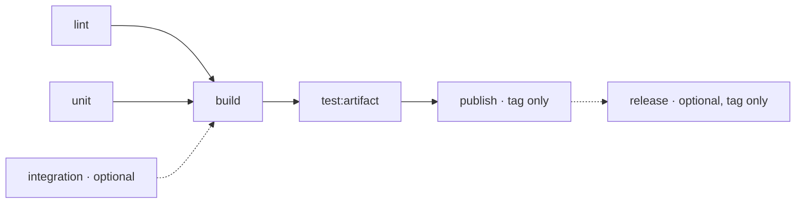
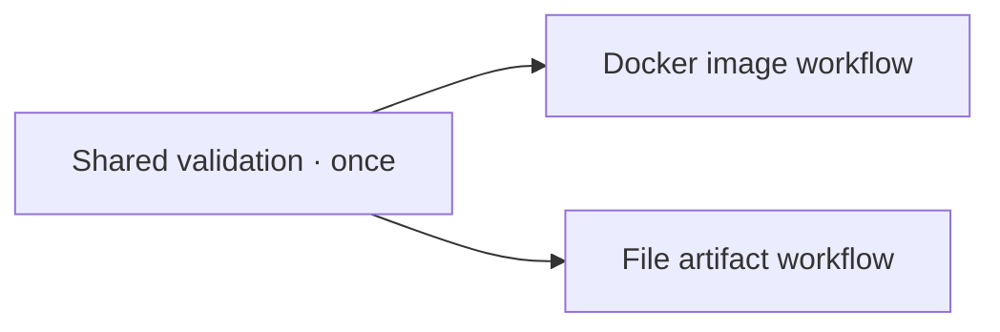

# Optional CI steps

Choose [Task commands](../examples/task-workflow.yaml) for file artifacts
or [Buildx](../examples/woodpecker.yaml) for Docker images.

## Choose capabilities

`task lint` and `task test:unit` are required.
Keep other steps only when the project implements that capability.

| Command | Responsibility |
| --- | --- |
| `task test:integration` | Test interactions with services or other components. |
| `task build` | Produce artifacts in the workspace, such as `dist/`. |
| `task test:artifact` | Check the built artifacts without rebuilding them. |
| `task publish` | Upload the tested artifacts. |
| `task release` | Publish release information after upload succeeds. |

Each project implements its own Task commands.
CI does not discover them automatically; a configured but missing task fails.



Only lint and unit are mandatory. The diagram shows all optional capabilities.

## Add integration tests

Add this step to the selected workflow and provision any services it needs:

```yaml
  - name: integration
    image: ghcr.io/revotale/ci/base:v0.1.5@sha256:6e63627e23192f3e6258776bc9eeca0cc42829b1c447bc252ece997541e73f09
    depends_on: []
    commands: [task test:integration]
```

Add `integration` to the existing dependencies of the first build step:

- Task workflow: `build.depends_on: [lint, unit, integration]`.
- Docker workflow: `test-image.depends_on: [lint, unit, integration]`.

Integration tests run once, in parallel with lint and unit tests.

## Add release publication

For the Task workflow, add this step after `publish`:

```yaml
  - name: release
    image: ghcr.io/revotale/ci/base:v0.1.5@sha256:6e63627e23192f3e6258776bc9eeca0cc42829b1c447bc252ece997541e73f09
    depends_on: [publish]
    when:
      - *release-tag
    commands: [task release]
```

The `release-tag` anchor is already defined in the example.
Provide the forge credentials expected by the task, for tag events only.

This task publishes release information; it must not rebuild or upload
the artifacts again. Artifact upload belongs to `publish`.

For Docker workflows, depend on `publish-image` instead of `publish`.

## Keep checks in one place

Choose one starting workflow. Do not combine the complete examples:
both already contain lint and unit tests.

When several artifact workflows need the same checks, move those checks
into one `.woodpecker/validate.yaml` and remove their local copies.
Each artifact workflow then declares:

```yaml
depends_on: [validate]
```

Remove references to the moved checks from step-level `depends_on`;
the workflow dependency now gates all artifact steps.
Keep validation event filters compatible with the dependent workflows.
See our [validation workflow](../.woodpecker/validate.yaml) and
[image matrix](../.woodpecker/image.yaml).



Only validation is shared here. Keep each file artifact's
build → test → publish steps in the same workflow so they share its files.

Do not repeat the same check through both Task and a plugin.
Check Task dependencies too: `build` must not rerun tests already completed
by CI, and `publish` must not rebuild the tested artifact.

PR, default-branch push and release-tag pipelines remain separate.
There is no cross-pipeline reuse of successful checks.

## Reuse event filters locally

The examples define event mappings as YAML anchors and reuse them in `when`.
Change the release-tag filter once per file.

Anchors do not cross file or repository boundaries. They reduce local
duplication; they do not centrally enforce organization policy.

Keep image names and versions explicit in every step.

## Configure the environment

Choose explicit images containing the tools each step needs.
Add services required by integration tests.

Steps in one workflow share workspace files, not installed packages or
running processes. Separate workflows do not share the workspace.

Add credentials only to the publishing steps that need them, with secrets
available only to tag events. Use the environment names your tasks expect.
The release version is available as `CI_COMMIT_TAG`.

## Docker images

Use the Buildx example for image builds, artifact checks and publication.
Do not duplicate these operations with Task steps.

Artifact tests and non-release builds omit `platforms`, using the BuildKit
builder's native platform. With our local builder, this is the CI agent's
platform. A remote builder uses its own platform.

Only tag publication sets `platforms: linux/arm64,linux/amd64`.
Testing additional platforms is opt-in: set `platforms` explicitly on the
relevant check step. Building both release platforms does not run the
artifact-test target on both.

The Task example does not configure cross-compilation. Its commands own
their build targets; keep checks native unless the project opts in.

## Release preparation

The tag-only `task release` example publishes release information.
The official ready-release-go workflow prepares release PRs on
default-branch pushes. Enable the operations your project needs.
