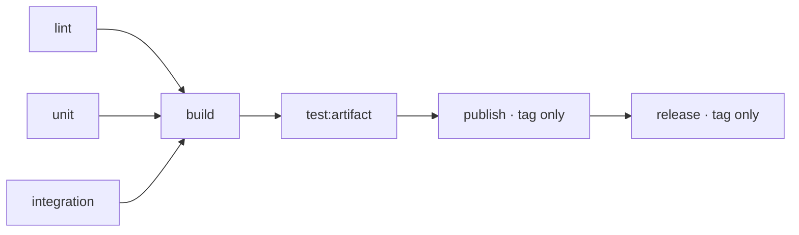

# Optional CI steps

Choose [Task commands](../examples/task-workflow.yaml) for file artifacts
or [Buildx](../examples/woodpecker.yaml) for Docker images.

## Choose capabilities

`task lint` and `task test:unit` are required.
Keep other steps only when the project implements that capability.

| Command | Responsibility |
| --- | --- |
| `task test:integration` | Test interactions with services or other components. |
| `task build` | Produce artifacts in the workspace, such as `dist/`. |
| `task test:artifact` | Check the built artifacts without rebuilding them. |
| `task publish` | Upload the tested artifacts. |
| `task release` | Publish release information after upload succeeds. |

Each project implements its own Task commands.
CI does not discover them automatically; a configured but missing task fails.



Only lint and unit are mandatory. The diagram shows all optional capabilities.

## Remove unused steps

Delete the step and update its downstream `depends_on`.

- Without integration tests: `build` depends on `[lint, unit]`.
- Without artifact tests: `publish` depends on `[build]`.
- Without publication or releases: remove `publish` and `release`.
- For checks only: keep `lint`, `unit` and any integration tests.

Do not add empty Task commands to satisfy the example.
Keep all required checks upstream of publication.

## Configure the environment

Choose explicit images containing the tools each step needs.
Add services required by integration tests.

Steps in one workflow share workspace files, not installed packages or
running processes. Separate workflows do not share the workspace.

Add credentials only to the publishing steps that need them, with secrets
available only to tag events. Use the environment names your tasks expect.
The release version is available as `CI_COMMIT_TAG`.

## Docker images

Use the Buildx example for image builds, artifact checks and publication.
Do not duplicate these operations with Task steps.

To add integration tests, copy the `integration` step and add it to
`test-image.depends_on`:

```yaml
depends_on: [lint, unit, integration]
```

Artifact tests and non-release builds omit `platforms`, using the BuildKit
builder's native platform. With our local builder, this is the CI agent's
platform. A remote builder uses its own platform.

Only tag publication sets `platforms: linux/arm64,linux/amd64`.
Testing additional platforms is opt-in: set `platforms` explicitly on the
relevant check step. Building both release platforms does not run the
artifact-test target on both.

The Task example does not configure cross-compilation. Its commands own
their build targets; keep checks native unless the project opts in.

## Release preparation

The tag-only `task release` example publishes release information.
The official ready-release-go workflow prepares release PRs on
default-branch pushes. Enable the operations your project needs.
